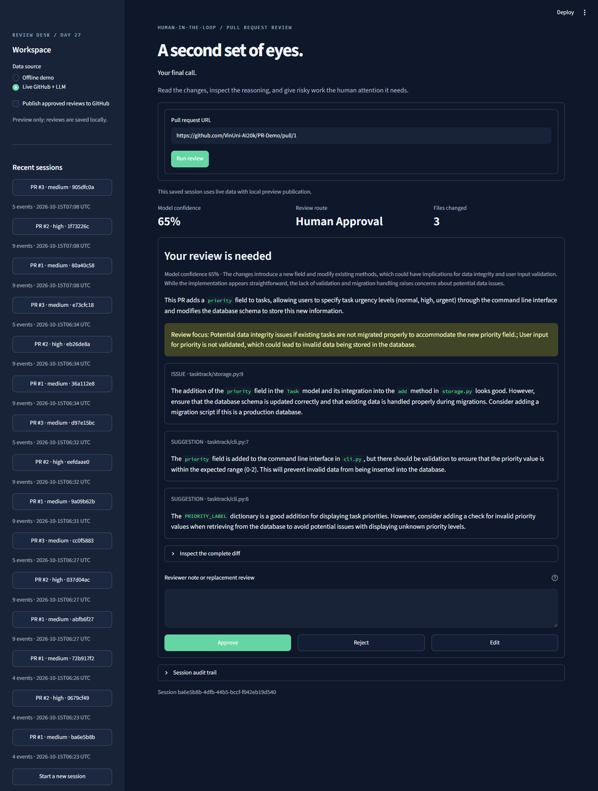
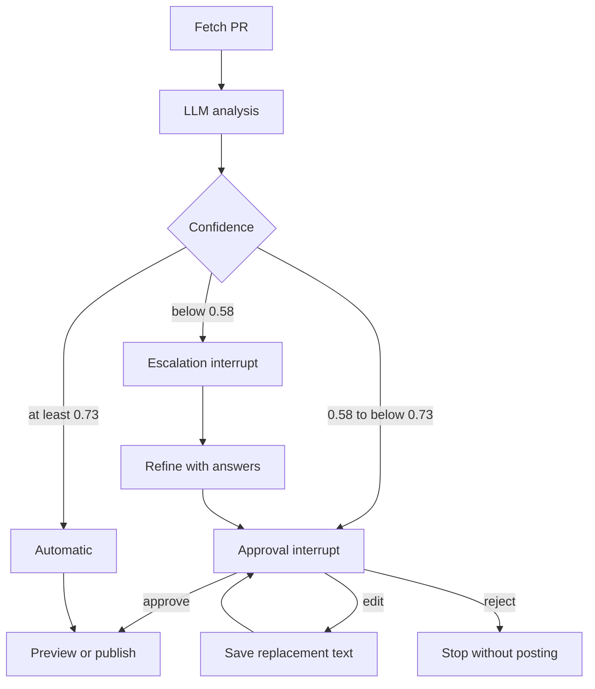

# Day27 · HITL PR Review Agent

**Trần Quốc Vượng · 2A202602522 · Cohort 4 / Track 3**

Agent review pull request bằng LangGraph, dừng chờ người duyệt khi cần, và lưu toàn bộ quyết định vào SQLite. Streamlit cung cấp giao diện đọc diff, Approve / Reject / Edit, trả lời escalation và mở lại phiên đã lưu.

[Đề bài gốc](docs/LAB.md) · [Báo cáo kết quả](reports/REPORT.md) · [Ảnh bằng chứng](screenshots/README.md)



## Repo cá nhân và chuẩn bị

Fork public: [Neon310304/K4-DAY27-TranQuocVuong-2A202602522](https://github.com/Neon310304/K4-DAY27-TranQuocVuong-2A202602522), từ `VinUni-AI20k/VinUni-AI20k-Day27-Track03-HITL`.

```bash
git clone https://github.com/Neon310304/K4-DAY27-TranQuocVuong-2A202602522.git
cd K4-DAY27-TranQuocVuong-2A202602522
uv sync --locked
git remote -v
```

`origin` phải trỏ tới fork cá nhân trên. Hướng dẫn key, token và kiểm tra quyền nằm ở [docs/SETUP.md](docs/SETUP.md); kết quả kiểm tra môi trường riêng trong [setup.json](reports/evidence/setup.json). Không cần Docker hoặc PostgreSQL.

## Chạy nhanh

Python 3.11+ và [uv](https://docs.astral.sh/uv/). Đã kiểm tra bằng Python 3.12 trên Windows.

```bash
uv sync --locked --group dev
uv run streamlit run app.py
```

Mở http://localhost:8501. Chọn **Offline demo** để thử ngay, không cần key: PR 1 vào approval, PR 2 vào escalation, PR 3 tự hoàn tất. Đây là dữ liệu tổng hợp, có nhãn trên UI; không được coi là kết quả LLM thật.

## Chạy GitHub + LLM thật

Sao chép `.env.example` thành `.env` nếu chưa có; không ghi đè `.env` hiện có. File được Git bỏ qua.

OpenRouter:

```dotenv
OPENROUTER_API_KEY=your_private_key
LLM_BASE_URL=https://openrouter.ai/api/v1
LLM_MODEL=openai/gpt-4o-mini
GITHUB_TOKEN=your_private_token
GITHUB_USER=your_github_username
HITL_PUBLISH_MODE=preview
```

YesScale hỗ trợ tên biến OpenAI-compatible, dùng thay cho ba biến LLM ở trên:

```dotenv
OPENAI_API_KEY=your_private_key
OPENAI_BASE_URL=https://api.yescale.io/v1
OPENAI_MODEL=gpt-4o-mini
```

`GITHUB_TOKEN` cần quyền `public_repo` để đăng bình luận ở repo public. Nếu Git Credential Manager đã đăng nhập GitHub, app có thể lấy credential vào bộ nhớ, không in hoặc ghi lại token. `GITHUB_USER` là attribution do người chạy cấu hình, không phải cơ chế xác thực reviewer của production.

Chọn **Live GitHub + LLM** và nhập URL PR. **UI và CLI Exercise 3/4 mặc định preview**: đọc PR thật, gọi model thật, giữ draft. Để thực sự đăng bình luận, bật **Publish approved reviews to GitHub** trước khi bắt đầu phiên, hoặc dùng `--publish` ở CLI. **CLI Exercise 2 mặc định đăng thật sau approve**, đúng checkpoint của đề; dùng `--preview` nếu chỉ muốn lưu draft. Nhánh automatic có thể đăng ngay khi chế độ publish được bật. Đây là bình luận thảo luận PR, không phải formal GitHub Approve hay merge code.

## Năm bài tập đã hoàn thiện

| Bài | File | Hành vi |
|---|---|---|
| 1 | `exercises/exercise_1_confidence.py` | Fetch PR, `with_structured_output(PRAnalysis)`, routing đủ ba nhánh |
| 2 | `exercises/exercise_2_hitl.py` | `MemorySaver`, `interrupt()`, resume cùng thread; approve đăng, reject/edit bỏ qua |
| 3 | `exercises/exercise_3_escalation.py` | Câu hỏi cụ thể, Q&A, phân tích lại, xác nhận review đã tinh chỉnh |
| 4 | `exercises/exercise_4_audit.py` | `AsyncSqliteSaver`, audit từng bước, resume cùng thread sau khi tắt chương trình |
| 5 | `app.py` | UI Streamlit, phiên gần đây, reload bằng URL thread, audit và tải draft |

Luồng đầy đủ của Exercise 3–5:



Ngưỡng chính xác lấy từ `common/schemas.py`: **`>= 0.73`**, **`0.58 <= c < 0.73`**, **`< 0.58`**. Confidence là tự đánh giá của model, chưa được calibration thành xác suất đúng. Không ép điểm theo ID PR.

Trong Exercise 2, `human_approval → commit`: chỉ `approve` đăng; cả `reject` và `edit` kết thúc `rejected`, không viết lại review. Panel **Approval request** hiển thị confidence, reasoning, summary, comments và đúng 2.000 ký tự đầu của diff. Node interrupt không đăng comment; vòng `while` resume dùng lại cùng `cfg` và `thread_id`.

Trong Exercise 3–5, Edit lưu **toàn bộ nội dung review thay thế** rồi yêu cầu xác nhận lần nữa. Escalation luôn được duyệt lại sau synthesize; câu trả lời của reviewer không tự xoá lỗi trong code. Đây là phần bổ sung so với đường `synthesize → commit` của starter để đáp ứng yêu cầu xác nhận cuối trong Exercise 5.

## CLI và replay

Chạy từ gốc repo; cú pháp module bảo đảm import hoạt động trên máy sạch:

```bash
uv run python exercises/exercise_1_confidence.py --pr https://github.com/VinUni-AI20k/PR-Demo/pull/1
uv run python exercises/exercise_1_confidence.py --pr https://github.com/VinUni-AI20k/PR-Demo/pull/2
uv run python exercises/exercise_2_hitl.py --pr https://github.com/VinUni-AI20k/PR-Demo/pull/1
uv run python -m exercises.exercise_3_escalation --pr https://github.com/VinUni-AI20k/PR-Demo/pull/2
uv run python -m exercises.exercise_4_audit --pr https://github.com/VinUni-AI20k/PR-Demo/pull/1
uv run python -m exercises.exercise_4_audit --pr https://github.com/VinUni-AI20k/PR-Demo/pull/1 --thread EXISTING_THREAD_ID
uv run python -m audit.replay --list
uv run python -m audit.replay --thread EXISTING_THREAD_ID
```

`--thread` mở checkpoint cũ, không fetch/analyze lại. CLI của Exercise 4 hỗ trợ `--demo` với URL `https://github.com/demo/shop/pull/1` hoặc `/2`, `/3`. Chỉ Exercise 4/5 lưu trạng thái bền; `MemorySaver` của Exercise 2/3 mất khi process tắt.

Exercise 2 hỗ trợ `--evidence reports/evidence/my-exercise2.json` để lưu snapshots và payload khi dừng/tiếp tục. Thêm `--preview` để approve chỉ tạo draft trong kết quả trả về; không ghi SQLite hoặc đăng GitHub.

Exercise 1 đã được chạy riêng bằng hai lệnh trực tiếp trong đề: PR #1 in `✓ HUMAN APPROVAL`, `confidence = 65%`, `action = pending_human_approval`; PR #2 in `✓ ESCALATE`, `confidence = 55%`, `action = pending_escalation`. [Output CLI thật](reports/evidence/exercise1_runs.json) tách riêng với hai checkpoint UI đã chạy trước đó; confidence có thể khác giữa các lần gọi. Không đổi ngưỡng và không đăng comment ở Exercise 1.

Exercise 2 có [checkpoint CLI thật](reports/evidence/exercise2_approval.json) với confidence **58%**, đang chờ người dùng duyệt [review cụ thể](reports/drafts/exercise2-review.md). [Reject replay](reports/evidence/exercise2_reject.json) dùng lại analysis đã lưu, trả `rejected` và không đăng comment; phản hồi đó do script kiểm thử nhập. Checkpoint đăng comment thật vẫn chờ duyệt; xem [phạm vi kiểm chứng](reports/evidence/exercise2_checks.json).

## Kiểm thử và evidence

```bash
uv run pytest -q
uv run ruff check exercises app.py scripts tests
uv run ruff format --check exercises app.py scripts tests
uv pip check
```

- **33 tests offline đạt**: routing ở biên, pause/resume, payload Exercise 2, không đăng trước interrupt, reject/edit không đăng, escalation, audit, publication adapter, lỗi publish và smoke test Streamlit.
- **8 kiểm tra Chrome đạt**, gồm reload checkpoint và màn hình 375px với reduced motion; không có JavaScript page errors.
- **API thật**: PR-Demo #1 đạt confidence **0.65 → human_approval**; PR-Demo #2 đạt **0.50 → escalate**, qua YesScale với model request `gpt-4o-mini`.
- Hai phiên thật dừng chờ reviewer. **Chưa đăng bình luận GitHub trong lần xác minh này**. Tương tác hoàn tất ở demo là phản hồi kiểm thử tổng hợp.

Evidence JSON trong `reports/evidence/`; ảnh Chrome thật trong `screenshots/`. [Phạm vi và phiên bản evidence](reports/evidence/README.md) phân biệt lần gọi API với bản source đã kiểm tra cuối. Không commit `.env` hoặc SQLite chứa checkpoint cá nhân. ID model ghi lại là tên gửi đến provider, không chứng minh snapshot nội bộ provider.

```bash
# Sinh evidence offline, không gọi mạng:
uv run python -m scripts.run_evidence

# Gọi API thật cho hai PR, dừng ở HITL; có chi phí provider:
uv run python -m scripts.run_evidence --live
```

CI chạy offline, không yêu cầu secrets. Các file được cấp trong `common/` và `audit/` giữ nguyên; giải pháp nằm ở `exercises/`, `app.py` và các module thêm mới.

## Lưu trữ và giới hạn

`HITL_DB_PATH` đặt đường dẫn database, mặc định `hitl_audit.db`. Checkpoint dùng để resume; bảng `audit_events` dùng truy vấn lịch sử. Lab dùng SQLite đúng hướng dẫn starter; chưa triển khai PostgreSQL.

Side effect đăng comment nằm sau interrupt. Reload/resume phiên đã hoàn tất không đăng lại. Nếu process chết sau khi GitHub nhận comment nhưng trước khi checkpoint commit, vẫn có cửa sổ có thể đăng trùng: marker cố định giúp đối chiếu, **không phải exactly-once delivery**. Production cần outbox/reconciliation và chống hai worker cùng xử lý một thread. App hiện dùng cho lab trên localhost, chưa có đăng nhập hoặc phân quyền nhiều người.
